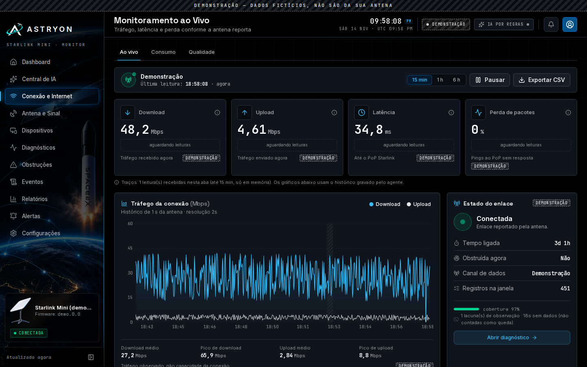

<div align="center">


### Monitoramento local da Starlink Mini

Painel em tempo real, alertas no Telegram, assistente de IA e controle seguro da antena.
Tudo rodando na sua rede, sem nuvem obrigatória e sem dado inventado.


</div>

<p align="center">
  
</p>

> **ASTRYON** é o nome do painel. O repositório, os pacotes, as variáveis `ORBITLINK_*` e os serviços
> `orbitlink-*` mantêm o nome técnico **OrbitLink**.
> Projeto independente, sem afiliação com a Starlink ou a SpaceX. Usa apenas a API local gRPC que a
> própria antena expõe na sua rede.

---

## Sumário

- [O que ele faz](#o-que-ele-faz)
- [Telas](#telas)
- [Princípios](#princípios)
- [Instalação](#instalação)
- [Telegram e IA](#telegram-e-ia)
- [Arquitetura](#arquitetura)
- [Estado do projeto](#estado-do-projeto)
- [Desenvolvimento](#desenvolvimento)
- [Documentação](#documentação)

## O que ele faz

| | Recurso | Detalhes |
|---|---|---|
| 📡 | **Ao vivo** | Download, upload, latência e perda de pacotes a cada segundo, com histórico, pausa e exportação CSV. |
| 📊 | **Consumo e franquia** | Consumo do ciclo, projeção mensal e alertas em 80% e 100% do plano (estimativa local pelo tráfego da antena). |
| ✅ | **Qualidade** | Disponibilidade, perda, jitter e percentis de latência por hora. Segundos sem medição ficam fora da conta. |
| 🛰️ | **Antena e obstruções** | Estado, firmware, mapa de céu visto pela antena e porcentagem de obstrução. |
| 🔔 | **Alertas** | Regras com debounce, histerese e cooldown, entregues pelo Telegram ou por webhook, com fila que sobrevive à queda da internet. |
| 🤖 | **Central de IA** | Perguntas em português respondidas com os dados do agente (Groq). Sem chave, responde por regras. |
| 💬 | **Bot do Telegram** | `/menu`, consultas por comando sem gastar IA, perguntas em texto ou nota de voz e resumo semanal. |
| 🔁 | **Controle seguro** | Reiniciar a antena exige administrador, código de uso único e fica auditado. A IA só sugere. |
| 🔌 | **ESP32 (opcional)** | Sensores de tensão, falta de energia e temperatura, autenticados por HMAC. |
| ☁️ | **Supabase (opcional)** | Sincronização com RLS. O painel continua lendo só o agente local. |

## Telas

<table>
  <tr>
    <td width="50%"><br><sub><b>Consumo</b>: ciclo, projeção e evolução diária.</sub></td>
    <td width="50%"><br><sub><b>Antena e Sinal</b>: estado, firmware e obstruções.</sub></td>
  </tr>
  <tr>
    <td><br><sub><b>Central de IA</b>: perguntas sobre a conexão com histórico de conversas.</sub></td>
    <td><br><sub><b>Login</b>: administrador local criado na instalação.</sub></td>
  </tr>
</table>

<details>
<summary><b>Dashboard completo e versão para celular</b></summary>
<br>
<p align="center">
  
  &nbsp;
  
</p>
</details>

Todas as capturas vêm da rota `/demo`, com dados fictícios e a faixa de demonstração sempre visível.

## Princípios

- **Funciona 100% local.** Sem Docker e sem serviço pago. Supabase, IA e ESP32 são opcionais.
- **Toda métrica mostra a origem**: `real`, `calculada`, `estimada`, `importada`, `sensor_esp32`, `indisponível` ou `demonstração`.
- **Nada é inventado.** Campo que o firmware não informa aparece como indisponível. Lacuna de observação nunca vira zero, e tráfego corrente nunca é chamado de teste de velocidade.
- **Ações só com confirmação humana.** A IA tem ferramentas somente de leitura.
- **Demonstração isolada.** Dados fictícios existem só em `/demo`, sempre sinalizados.

## Instalação

**Pré-requisitos:** Python 3.11+ e Node.js 20+ (LTS). Antena na mesma rede (`192.168.100.1`).

### Servidor Linux (Ubuntu Server 24.04 LTS), recomendado

```bash
git clone https://github.com/carlosnj497-lgtm/orbitlink-ai.git ~/orbitlink && cd ~/orbitlink
sudo bash deploy/linux/install.sh        # systemd + Nginx (TLS) + UFW
sudo cat /etc/orbitlink/setup-code       # código para criar o 1º administrador
```

Depois abra `https://IP-DO-SERVIDOR/` e crie o administrador. Opções do instalador: `--with-tailscale`, `--esp32` e `--harden-ssh`.

```bash
sudo orbitlinkctl status | logs agent -f | diagnose | doctor | restart | update --git-pull | rollback | backup
```

Os serviços `orbitlink-agent` e `orbitlink-web` reiniciam sozinhos em falhas e registram no journald. Agente e painel escutam só em loopback; o Nginx publica o painel apenas para a LAN e a Tailnet. Guia completo: [docs/LINUX_SERVER.md](docs/LINUX_SERVER.md).

### Windows 10/11 (PowerShell)

```powershell
powershell -ExecutionPolicy Bypass -File scripts\install.ps1    # venv, npm, .env com token, build
powershell -ExecutionPolicy Bypass -File scripts\diagnose.ps1   # rede + antena (somente leitura)
powershell -ExecutionPolicy Bypass -File scripts\start.ps1      # agente :8787 + painel :3000
```

Abra <http://127.0.0.1:3000> e crie o administrador. Para parar: `scripts\stop.ps1`. Guia: [docs/WINDOWS_SETUP.md](docs/WINDOWS_SETUP.md).

> Sem antena por perto? Abra `/demo` para ver o painel com dados fictícios.

## Telegram e IA

1. Crie um bot no [@BotFather](https://t.me/BotFather) e coloque o token em `ORBITLINK_TELEGRAM_BOT_TOKEN`.
2. Descubra o chat autorizado com `sudo orbitlinkctl telegram-chat-id` (ou `python -m orbitlink_agent telegram-chat-id`) e preencha `ORBITLINK_TELEGRAM_CHAT_ID`.
3. Opcional: coloque uma chave da [Groq](https://console.groq.com/keys) em `ORBITLINK_GROQ_API_KEY` para respostas com IA e transcrição de notas de voz (Whisper).

| Comando | O que mostra |
|---|---|
| `/menu` | Central com botões |
| `/status` | Diagnóstico das últimas 24 h |
| `/consumo 7d` | Download, upload e cobertura no período |
| `/franquia` | Limite, saldo estimado e projeção do ciclo |
| `/qualidade` · `/quedas` · `/alertas` | Qualidade, interrupções e alertas ativos |
| `/resumo` | Resumo dos últimos 7 dias |

Consultas por comando não gastam IA. Perguntas em texto ou voz usam a cota diária, compartilhada com o painel. Todos os comandos: [docs/TELEGRAM.md](docs/TELEGRAM.md).

## Arquitetura

```
 Navegador ──HTTPS──▶ Nginx ──▶ Painel Next.js (127.0.0.1:3000)
                                  │  /api/auth/*   login → cookie httpOnly, SameSite=Strict
                                  │  /api/agent/*  proxy autenticado (+ SSE), token nunca vai ao navegador
                                  ▼
                       Agente FastAPI (127.0.0.1:8787) ──gRPC──▶ Starlink Mini (192.168.100.1:9200)
                         ├─ Coletor (status 10 s · histórico 30 s · obstrução 5 min)
                         ├─ SQLite WAL + migrações + retenção automática
                         ├─ Alertas · Diagnóstico por regras · Relatórios · Controle auditado
                         ├─ Bot do Telegram · IA Groq (somente leitura) · Whisper
                         └─ Sync opcional ──HTTPS──▶ Supabase (RLS)
                       Listener ESP32 (opcional, HMAC) ◀── sensores na LAN
```

| Pasta | Conteúdo |
|---|---|
| `apps/agent/` | Agente Python: FastAPI, gRPC por reflection, SQLite, SSE, alertas, IA, Telegram e sync |
| `apps/web/` | Painel ASTRYON: Next.js 16 (App Router), Tailwind 4, TanStack Query, Recharts |
| `apps/esp32-firmware/` | Firmware PlatformIO/Arduino do nó ESP32 |
| `packages/shared/` | Contratos TS e tipos gerados do OpenAPI do agente |
| `supabase/` | Migrações SQL com RLS e testes de isolamento (PGlite) |
| `deploy/linux/` | Instalador, systemd, Nginx, UFW e `orbitlinkctl` |
| `scripts/` | Scripts do Windows e emulador do ESP32 |

Decisões de projeto e fluxo de dados: [docs/ARCHITECTURE.md](docs/ARCHITECTURE.md).

## Estado do projeto

| Componente | Situação |
|---|---|
| Conector gRPC | Testado contra servidor gRPC sintético com reflection. **Ainda não validado em antena real** (a Mini não chegou). |
| Agente | 158 testes pytest, ruff e mypy strict. Dependências travadas com hash. |
| Painel | 52 testes Vitest e 9 E2E Playwright (incluindo acessibilidade com axe). |
| Telegram e notificações | Comandos, fila de reenvio e resumo semanal testados com servidor simulado. |
| IA (Groq) e Whisper | Testados com o endpoint real da Groq; áudio validado com voz sintética. |
| Supabase | 11 testes de isolamento RLS em Postgres (PGlite). Ainda não aplicado a um projeto real. |
| Firmware ESP32 | Compila (`esp32dev` e `esp32dev_sensors`). Ainda não gravado em placa. |
| Implantação Linux | 51 testes dos scripts e instalação real num Ubuntu 24.04 limpo no CI. |
| Painel remoto via Supabase | Não implementado: a nuvem recebe os dados, mas o painel lê só o agente local. |

## Desenvolvimento

| Comando (na raiz) | O que faz |
|---|---|
| `npm run dev` | Painel em modo desenvolvimento |
| `npm run test` | pytest + Vitest + testes de RLS |
| `npm run test:e2e` | Playwright: agente em modo fixture + painel em produção |
| `npm run lint` · `npm run typecheck` | ESLint + ruff · tsc + mypy strict |
| `npm run build` | Build de produção do painel |
| `npm run diagnose` | Diagnóstico da rede e da antena |
| `npm run gen:types` | Regenera os tipos TS a partir do OpenAPI do agente |
| `npm run lock:agent` | Regenera os `.lock` do Python (requer `uv`) |
| `npm run audit` | Vulnerabilidades conhecidas (`npm audit` + `pip-audit`) |
| `npm run test:deploy` | Testes dos scripts do servidor Linux |

Ao mudar dependências em `apps/agent/pyproject.toml`, rode `npm run lock:agent` e faça commit dos dois `.lock`: o CI falha se estiverem desatualizados.

O CI ([`.github/workflows/ci.yml`](.github/workflows/ci.yml)) roda agente, painel, Supabase, E2E, scripts, auditoria de vulnerabilidades e uma instalação real no Ubuntu a cada push e pull request.

## Documentação

| Guia | Assunto |
|---|---|
| [LINUX_SERVER.md](docs/LINUX_SERVER.md) | Servidor Ubuntu: instalação, atualização, backup e rollback |
| [WINDOWS_SETUP.md](docs/WINDOWS_SETUP.md) | Instalação no Windows |
| [TELEGRAM.md](docs/TELEGRAM.md) | Bot, comandos, voz e resumo semanal |
| [ARCHITECTURE.md](docs/ARCHITECTURE.md) | Decisões e fluxo de dados |
| [STARLINK_COMPATIBILITY.md](docs/STARLINK_COMPATIBILITY.md) | O que a API local informa e o que não informa |
| [SECURITY.md](docs/SECURITY.md) | Modelo de segurança |
| [ESP32_SETUP.md](docs/ESP32_SETUP.md) | Montagem e pareamento do ESP32 |
| [SUPABASE.md](docs/SUPABASE.md) | Sincronização opcional com a nuvem |
| [TROUBLESHOOTING.md](docs/TROUBLESHOOTING.md) | Solução de problemas |
| [ACCEPTANCE_TESTS.md](docs/ACCEPTANCE_TESTS.md) | Testes de aceitação |

## Créditos

A leitura do histórico circular da antena segue o modelo documentado pela
[starlink-grpc-tools](https://github.com/sparky8512/starlink-grpc-tools) (Unlicense). O código foi reescrito, não copiado.
