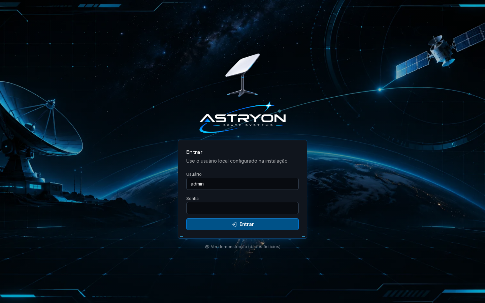
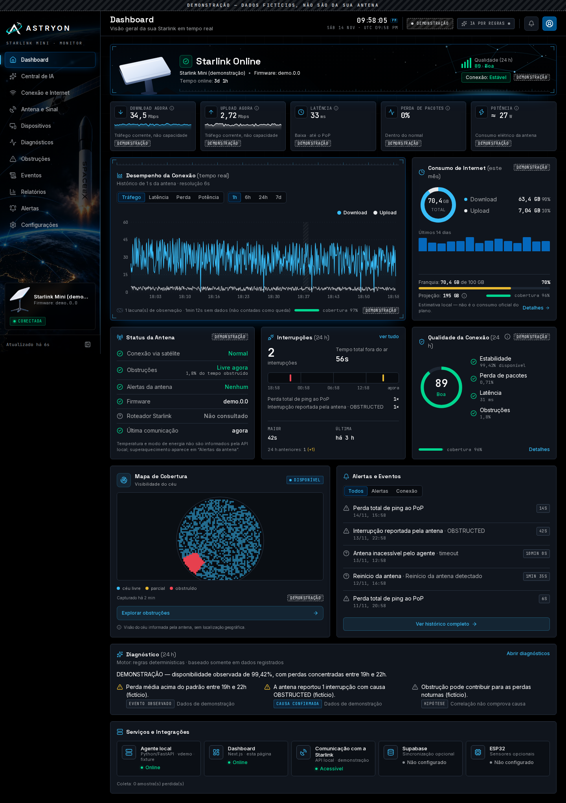
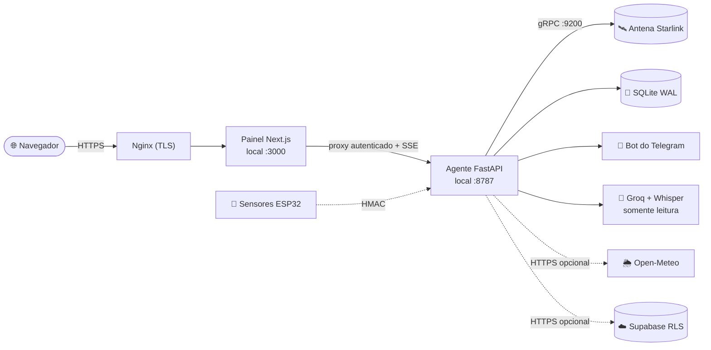
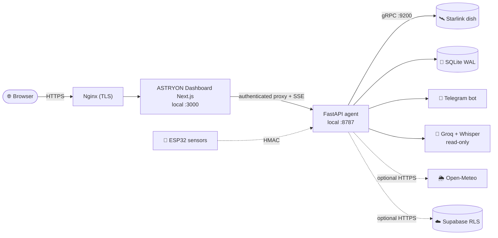

<div align="center">


# ASTRYON

### 📡 Monitoramento local da sua antena Starlink, com histórico completo.

**Painel em tempo real · Alertas no Telegram · Assistente de IA · Controle auditado da antena**

<sub>100% na sua rede — sem Docker, sem nuvem obrigatória, sem dado inventado.</sub>

<!-- Ações principais -->
[](https://github.com/carlosnj497-lgtm/orbitlink-ai/releases/latest)
[](#-telas)
[](#-documentação)
[](#-english)

<!-- Status do projeto -->
[](https://github.com/carlosnj497-lgtm/orbitlink-ai/actions/workflows/ci.yml)
[](https://github.com/carlosnj497-lgtm/orbitlink-ai/releases/latest)
[](LICENSE)
[](https://github.com/carlosnj497-lgtm/orbitlink-ai/stargazers)

<!-- Stack -->


<sub>🐛 Encontrou um problema? [Abra uma issue](https://github.com/carlosnj497-lgtm/orbitlink-ai/issues)</sub>

</div>

<p align="center">
  <br>
  <sub>Tela Ao Vivo na demonstração (dados fictícios, acelerada 4×) / Live screen in demo mode (fictitious data, 4× speed).</sub>
</p>

---

<p align="center">🇧🇷 <b>Português</b> · 🇺🇸 <a href="#-english">English</a></p>

## 🚀 Início rápido (Linux)

**Pré-requisitos:** Python 3.11+ e Node.js 20+ num computador ligado na mesma rede da antena.

🐧 **Linux (recomendado)** · 🪟 [Windows 10/11](#-instalação)

1. **Clone o repositório e entre na pasta**

   ```bash
   git clone https://github.com/carlosnj497-lgtm/orbitlink-ai.git ~/astryon
   cd ~/astryon
   ```

2. **Instale e suba os serviços**

   ```bash
   sudo bash deploy/linux/install.sh
   ```

3. **Copie o código de configuração**

   ```bash
   sudo cat /etc/astryon/setup-code
   ```

4. Abra `https://SEU-IP/` e crie o administrador com esse código.

Pronto — o agente está no ar e vai começar a ler a sua antena assim que ela estiver acessível na rede. 📡

O projeto usa o mesmo prefixo em tudo: variáveis `ASTRYON_*`, serviços `astryon-*` e o comando `astryonctl`.

🎮 **Sem antena por perto?** Abra `/demo` · 🔄 **Vindo do nome antigo?** Veja [Migração para ASTRYON](docs/MIGRATION_ASTRYON.md)

> [!IMPORTANT]
> **Projeto independente, sem afiliação com a Starlink ou a SpaceX.** Usa apenas a API local gRPC que a própria antena expõe na sua rede.
>
> **Modelos:** Mini · Standard (e gerações anteriores) · Standard Actuated · High Performance · Flat High Performance. A compatibilidade depende do firmware de cada antena — a validação em hardware real ainda está pendente. Veja a [compatibilidade por modelo](docs/STARLINK_COMPATIBILITY.md).

---

## 📑 Sumário

**🚀 Começando**
- [Início rápido](#-início-rápido-linux)
- [Instalação](#-instalação)

**🛰️ O projeto**
- [Por que ASTRYON?](#-por-que-o-astryon)
- [O que ele faz](#-o-que-ele-faz)
- [Telas](#-telas)
- [Princípios](#-princípios)
- [Arquitetura](#-arquitetura)
- [Estado do projeto](#-estado-do-projeto)
- [Roteiro](#-roteiro)

**🔌 Uso e integrações**
- [Telegram e IA](#-telegram-e-ia)
- [Perguntas frequentes](#-perguntas-frequentes)
- [Documentação](#-documentação)

**🤝 Comunidade**
- [Desenvolvimento](#-desenvolvimento)
- [Contribuição](#-contribuição)
- [Créditos](#-créditos--credits)

🌐 [English version](#-english)

## 💡 Por que o ASTRYON?

O app oficial da Starlink mostra o estado atual e um histórico recente. O ASTRYON guarda o que a antena expõe — amostras de 1 s, agregados por minuto e eventos — e transforma esses dados em painel, alertas e respostas:

| 📱 App oficial | 🛰️ Com o ASTRYON |
|---|---|
| Status atual + histórico curto | 🗂️ **Seu histórico** — amostras de 1 s por 7 dias e agregados por minuto por 400 dias (padrão), no seu computador |
| Quedas recentes no histórico do app | 🌙 **Quedas registradas** — horário, duração e causa (quando a antena informa), inclusive de madrugada |
| Franquia na conta/app | 📦 **Franquia estimada** — consumo do ciclo, projeção do mês e avisos em 80% e 100% (estimativa local) |
| Alertas no app oficial | 📲 **Telegram** — alertas, resumo semanal e consultas, sem abrir o painel |
| Dados da antena | 🌧️ **Chuva ou antena?** — clima e conexão lado a lado, para comparar (sem afirmar causalidade) |
| Gráficos e estatísticas prontos | 🗣️ **Pergunte em português** — respostas com fonte e incerteza (IA Groq ou regras) |
| Dados na nuvem da Starlink | 🔒 **Dados com você** — tudo na sua rede; nuvem e serviços opcionais só se você configurar |

## ✨ O que ele faz

| | Recurso | Detalhes |
|---|---|---|
| 📡 | **Ao vivo** | Download, upload, latência e perda de pacotes a cada segundo, com histórico, pausa e exportação CSV. |
| 📊 | **Consumo e franquia** | Consumo do ciclo, projeção mensal e alertas em 80% e 100% do plano (estimativa local pelo tráfego da antena). |
| ✅ | **Qualidade** | Disponibilidade, perda, jitter e percentis de latência por hora, comparação com o período anterior (com e sem chuva) e os melhores horários do dia. Segundos sem medição ficam fora da conta. |
| 🛰️ | **Antena e obstruções** | Estado, firmware, mapa de céu visto pela antena e porcentagem de obstrução. |
| 🔔 | **Alertas** | Regras com debounce, histerese e cooldown, entregues pelo Telegram ou por webhook, com fila que sobrevive à queda da internet. |
| 🤖 | **Central de IA** | Perguntas em português respondidas com os dados do agente (Groq). Sem chave, responde por regras. |
| 💬 | **Bot do Telegram** | `/menu`, consultas por comando sem gastar IA, perguntas em texto ou nota de voz e resumo semanal. |
| 🔁 | **Controle seguro e auditado** | Reiniciar a antena exige administrador, código de uso único e fica auditado. A IA só sugere. |
| 🌦️ | **Clima (opcional)** | Clima da sua cidade pela Open-Meteo (gratuita): cartão no Dashboard, faixas de chuva nos gráficos e o tempo de cada queda em Eventos. |
| 🔌 | **ESP32 (opcional)** | Sensores de tensão, falta de energia e temperatura, autenticados por HMAC. |
| 🏠 | **Home Assistant (opcional)** | Sensores da Starlink no Home Assistant via MQTT, com descoberta automática. Veja [HOME_ASSISTANT.md](docs/HOME_ASSISTANT.md). |
| ☁️ | **Supabase (opcional)** | Sincronização com RLS. O painel continua lendo só o agente local. |

## 📺 Telas

<table>
  <tr>
    <td width="50%"><br><sub><b>Consumo</b>: ciclo, projeção e evolução diária.</sub></td>
    <td width="50%"><br><sub><b>Antena e Sinal</b>: estado, firmware e obstruções.</sub></td>
  </tr>
  <tr>
    <td><br><sub><b>Central de IA</b>: perguntas sobre a conexão com histórico de conversas.</sub></td>
    <td><br><sub><b>Login</b>: administrador local criado na instalação.</sub></td>
  </tr>
</table>

<details>
<summary><b>Dashboard completo e versão para celular</b></summary>
<br>
<p align="center">
  
  &nbsp;
  
</p>
</details>

Todas as capturas vêm da rota `/demo`, com dados fictícios e a faixa de demonstração sempre visível.

## 💎 Princípios

- **Funciona 100% local.** Sem Docker e sem serviço pago. Supabase, IA e ESP32 são opcionais.
- **Toda métrica mostra a origem**: `real`, `calculada`, `estimada`, `importada`, `sensor_esp32`, `indisponível` ou `demonstração`.
- **Nada é inventado.** Campo que o firmware não informa aparece como indisponível. Lacuna de observação nunca vira zero, e tráfego corrente nunca é chamado de teste de velocidade.
- **Ações só com confirmação humana.** A IA tem ferramentas somente de leitura.
- **Demonstração isolada.** Dados fictícios existem só em `/demo`, sempre sinalizados.

## 🔧 Instalação

**Pré-requisitos:** Python 3.11+ e Node.js 20+ (LTS). Computador na mesma rede da antena (o agente precisa alcançar o IP local dela).

### Servidor Linux (Ubuntu Server 24.04 LTS), recomendado

Siga os passos do [Início rápido](#-início-rápido-linux). O instalador configura systemd + Nginx (TLS) + UFW, e o código em `/etc/astryon/setup-code` cria o primeiro administrador. Opções do instalador: `--with-tailscale`, `--esp32` e `--harden-ssh`.

```bash
sudo astryonctl status | logs agent -f | diagnose | doctor | restart | update --git-pull | rollback | backup
```

Os serviços `astryon-agent` e `astryon-web` reiniciam sozinhos em falhas e registram no journald. Agente e painel escutam só em loopback; o Nginx publica o painel apenas para a LAN e a Tailnet. Guia completo: [docs/LINUX_SERVER.md](docs/LINUX_SERVER.md).

### Windows 10/11 (PowerShell)

```powershell
powershell -ExecutionPolicy Bypass -File scripts\install.ps1    # venv, npm, .env com token, build
powershell -ExecutionPolicy Bypass -File scripts\diagnose.ps1   # rede + antena (somente leitura)
powershell -ExecutionPolicy Bypass -File scripts\start.ps1      # agente :8787 + painel :3000
```

Abra `http://localhost:3000` no próprio PC e crie o administrador. Para parar: `scripts\stop.ps1`. Guia: [docs/WINDOWS_SETUP.md](docs/WINDOWS_SETUP.md).

Prefere o instalador com ícone na bandeja? Baixe o `.exe` nas [releases do ASTRYON](https://github.com/carlosnj497-lgtm/orbitlink-ai/releases/latest) (em validação num Windows real).

> [!TIP]
> Sem antena por perto? Abra `/demo` para ver o painel com dados fictícios.

## 🤖 Telegram e IA

1. Crie um bot no [@BotFather](https://t.me/BotFather) e coloque o token em `ASTRYON_TELEGRAM_BOT_TOKEN`.
2. Descubra o chat autorizado com `sudo astryonctl telegram-chat-id` (ou `python -m astryon_agent telegram-chat-id`) e preencha `ASTRYON_TELEGRAM_CHAT_ID`.
3. Opcional: coloque uma chave da [Groq](https://console.groq.com/keys) em `ASTRYON_GROQ_API_KEY` para respostas com IA e transcrição de notas de voz (Whisper).

| Comando | O que mostra |
|---|---|
| `/menu` | Central com botões |
| `/status` | Diagnóstico das últimas 24 h |
| `/consumo 7d` | Download, upload e cobertura no período |
| `/franquia` | Limite, saldo estimado e projeção do ciclo |
| `/qualidade` · `/quedas` · `/alertas` | Qualidade, interrupções (com o clima de cada uma) e alertas ativos |
| `/clima` | Clima agora, próximas horas e aviso de chuva forte |
| `/horario` | Melhores horários para downloads e chamadas |
| `/resumo` | Resumo dos últimos 7 dias |
| `/relatorio` | PDF dos últimos 30 dias, com comparação e clima |

Consultas por comando não gastam IA. Perguntas em texto ou voz usam a cota diária, compartilhada com o painel. Todos os comandos: [docs/TELEGRAM.md](docs/TELEGRAM.md).

## 🧩 Arquitetura



O coletor lê o status a cada 10 s, o histórico a cada 30 s e as obstruções a cada 5 min, gravando no SQLite (WAL, migrações e retenção automática). O login usa cookie httpOnly (`SameSite=Strict`) e o painel fala com o agente por um proxy autenticado: o token nunca chega ao navegador. Alertas, diagnóstico por regras, relatórios e o controle auditado da antena rodam dentro do agente; o clima envia só as coordenadas da cidade, e a sincronização com o Supabase usa RLS. O listener ESP32 autentica os sensores por HMAC.

| Pasta | Conteúdo |
|---|---|
| `apps/agent/` | Agente Python: FastAPI, gRPC por reflection, SQLite, SSE, alertas, IA, Telegram e sync |
| `apps/web/` | Painel ASTRYON: Next.js 16 (App Router), Tailwind 4, TanStack Query, Recharts |
| `apps/esp32-firmware/` | Firmware PlatformIO/Arduino do nó ESP32 |
| `packages/shared/` | Contratos TS e tipos gerados do OpenAPI do agente |
| `supabase/` | Migrações SQL com RLS e testes de isolamento (PGlite) |
| `deploy/linux/` | Instalador, systemd, Nginx, UFW e `astryonctl` |
| `scripts/` | Scripts do Windows e emulador do ESP32 |

Decisões de projeto e fluxo de dados: [docs/ARCHITECTURE.md](docs/ARCHITECTURE.md).

## 🚦 Estado do projeto

| Componente | Situação |
|---|---|
| Conector gRPC | Testado contra servidor gRPC sintético com reflection. **Ainda não validado em antenas reais**; a compatibilidade por modelo e firmware precisa ser confirmada. |
| Agente | Testes pytest, ruff e mypy strict. Dependências travadas com hash. |
| Painel | Testes Vitest e E2E Playwright (incluindo acessibilidade com axe). |
| Telegram e notificações | Comandos, fila de reenvio e resumo semanal testados com servidor simulado. |
| IA (Groq) e Whisper | Testados com o endpoint real da Groq; áudio validado com voz sintética. |
| Supabase | Testes de isolamento RLS em Postgres (PGlite). Ainda não aplicado a um projeto real. |
| Firmware ESP32 | A versão 0.2.0 com pareamento v2 ainda precisa de compilação nos dois ambientes e validação em placa. |
| Implantação Linux | Testes dos scripts e instalação real num Ubuntu 24.04 limpo no CI. |
| Painel na nuvem (Vercel + Supabase) | Login por e-mail, pareamento por código, Dashboard, Consumo, Qualidade, Eventos e Conta. Testado com Supabase simulado; falta publicar e aplicar o SQL no seu projeto. |

## 🧭 Roteiro

- [x] Coleta gRPC por reflection, histórico de 1 s e agregados por minuto
- [x] Painel ASTRYON com Ao Vivo, Consumo, Qualidade, Antena, Obstruções, Eventos e Relatórios
- [x] Alertas com fila de reenvio, bot do Telegram e resumo semanal
- [x] Central de IA (Groq) e notas de voz transcritas pelo Whisper
- [x] Instalação no Ubuntu com systemd, Nginx e UFW, testada no CI
- [x] Clima da cidade (Open-Meteo) cruzado com a qualidade e as quedas
- [x] Aviso de chuva forte prevista no Telegram e comando `/clima`
- [ ] Validação em antenas Starlink reais dos diferentes modelos e gerações
- [ ] Nó ESP32 gravado e testado numa placa
- [x] Serviço na nuvem: conta por e-mail, código de pareamento e painel lendo o Supabase ([NUVEM.md](docs/NUVEM.md))
- [ ] Aparelho pronto (Raspberry Pi) com página de configuração: script pronto, falta testar no hardware ([APARELHO.md](docs/APARELHO.md))
- [ ] Instalador `.exe` para Windows com ícone na bandeja: gerado no GitHub Actions e publicado nas [releases do ASTRYON](https://github.com/carlosnj497-lgtm/orbitlink-ai/releases), falta validar num Windows real

## ❓ Perguntas frequentes

<details>
<summary><b>Quais modelos de antena Starlink posso usar?</b></summary>
<br>
O projeto é voltado aos modelos Starlink em geral, incluindo <b>Mini, Standard (e gerações anteriores),
Standard Actuated, High Performance e Flat High Performance</b>, desde que exponham a API local gRPC
acessível ao agente (IP da antena, porta 9200). O agente descobre em tempo de execução quais chamadas
o firmware oferece; o que não for informado aparece como indisponível. A validação em hardware real
ainda está pendente, portanto não há garantia de compatibilidade completa com todos os modelos e firmwares.
Detalhes em <a href="docs/STARLINK_COMPATIBILITY.md">STARLINK_COMPATIBILITY.md</a>.
</details>

<details>
<summary><b>Preciso de um servidor ligado o tempo todo?</b></summary>
<br>
Para monitorar 24 horas, sim: qualquer mini PC ou computador antigo com Ubuntu serve. No Windows, o monitoramento
acontece enquanto o computador estiver ligado.
</details>

<details>
<summary><b>Meus dados vão para algum lugar?</b></summary>
<br>
Não por padrão. Tudo fica no SQLite local. Só sai alguma coisa se você ativar o Telegram, a IA da Groq (a pergunta e
os dados necessários para respondê-la), as respostas em voz do bot (o texto da resposta vai ao serviço de voz da
Microsoft), o clima (só as coordenadas da cidade escolhida, arredondadas a cerca de 1 km, vão para a Open-Meteo) ou a
sincronização com o seu próprio projeto Supabase.
</details>

<details>
<summary><b>O clima diz que a chuva derrubou a minha internet?</b></summary>
<br>
Não. Ele mostra que as duas coisas aconteceram ao mesmo tempo, o que ajuda a investigar, mas não prova a causa. O clima
vem de um modelo meteorológico para a sua região, não de um sensor no seu telhado, por isso aparece como dado
<b>estimado</b>. Para ativar, escolha a cidade em Configurações → Clima; sem cidade, nada é buscado.
</details>

<details>
<summary><b>Quanto custa?</b></summary>
<br>
O projeto não tem custo. Telegram e o clima (Open-Meteo) são gratuitos. A IA usa a sua própria chave da Groq, que tem plano gratuito; sem chave,
o assistente responde por regras. Há cotas diárias configuráveis para texto e áudio.
</details>

<details>
<summary><b>O consumo mostrado é o mesmo da fatura?</b></summary>
<br>
Não necessariamente. O consumo é estimado pelo tráfego que a antena reporta a cada segundo, e o painel deixa isso claro.
Períodos sem observação ficam fora da conta. Para comparar, importe o CSV da sua conta Starlink.
</details>

<details>
<summary><b>A IA pode reiniciar a minha antena?</b></summary>
<br>
Não. As ferramentas da IA são somente de leitura. Reiniciar exige um administrador, um código de uso único e fica
registrado na auditoria.
</details>

## 💻 Desenvolvimento

| Comando (na raiz) | O que faz |
|---|---|
| `npm run dev` | Painel em modo desenvolvimento |
| `npm run test` | pytest + Vitest + testes de RLS |
| `npm run test:e2e` | Playwright: agente em modo fixture + painel em produção |
| `npm run lint` · `npm run typecheck` | ESLint + ruff · tsc + mypy strict |
| `npm run build` | Build de produção do painel |
| `npm run diagnose` | Diagnóstico da rede e da antena |
| `npm run gen:types` | Regenera os tipos TS a partir do OpenAPI do agente |
| `npm run lock:agent` | Regenera os `.lock` do Python (requer `uv`) |
| `npm run audit` | Vulnerabilidades conhecidas (`npm audit` + `pip-audit`) |
| `npm run test:deploy` | Testes dos scripts do servidor Linux |

Ao mudar dependências em `apps/agent/pyproject.toml`, rode `npm run lock:agent` e faça commit dos dois `.lock`: o CI falha se estiverem desatualizados.

O CI ([`.github/workflows/ci.yml`](.github/workflows/ci.yml)) roda agente, painel, Supabase, E2E, scripts, auditoria de vulnerabilidades e uma instalação real no Ubuntu a cada push e pull request.

## 🤝 Contribuição

- Achou um problema ou tem uma sugestão? Abra uma [issue](https://github.com/carlosnj497-lgtm/orbitlink-ai/issues).
- Pull requests são bem-vindos: antes de enviar, rode `npm run test` e `npm run lint` (o CI reprova se algo falhar).
- Se o projeto te ajudou, deixe uma ⭐ no repositório — isso ajuda outras pessoas a encontrá-lo.

## 📚 Documentação

### 🚀 Começando

| Guia | O que tem dentro |
|---|---|
| [🐧 Servidor Ubuntu](docs/LINUX_SERVER.md) | Instalação, atualização, backup e rollback |
| [🪟 Windows 10/11](docs/WINDOWS_SETUP.md) | Instalação e scripts no Windows |
| [🔄 Migração para ASTRYON](docs/MIGRATION_ASTRYON.md) | Atualização de instalações com o nome anterior |
| [🔍 Solução de problemas](docs/TROUBLESHOOTING.md) | Diagnóstico da rede, da antena e dos serviços |

### 🔌 Integrações

| Guia | O que tem dentro |
|---|---|
| [📲 Telegram](docs/TELEGRAM.md) | Bot, comandos, voz e resumo semanal |
| [📡 ESP32](docs/ESP32_SETUP.md) | Montagem e pareamento do nó de sensores |
| [🏠 Home Assistant](docs/HOME_ASSISTANT.md) | Sensores via MQTT com descoberta automática |
| [☁️ Nuvem (Vercel + Supabase)](docs/NUVEM.md) | Contas por e-mail, pareamento e painel na nuvem |
| [🔄 Supabase](docs/SUPABASE.md) | Sincronização opcional com RLS |
| [🍓 Aparelho pronto](docs/APARELHO.md) | Raspberry Pi com página de configuração |

### 🧠 Referência técnica

| Guia | O que tem dentro |
|---|---|
| [🧩 Arquitetura](docs/ARCHITECTURE.md) | Decisões de projeto e fluxo de dados |
| [🛰️ Compatibilidade Starlink](docs/STARLINK_COMPATIBILITY.md) | O que a API local informa — e o que não informa |
| [🛡️ Segurança](docs/SECURITY.md) | Modelo de segurança |
| [✅ Testes de aceitação](docs/ACCEPTANCE_TESTS.md) | Roteiro de validação ponta a ponta |

---

## 🇺🇸 English

### 🚀 Quick start (Linux)

**Prerequisites:** Python 3.11+ and Node.js 20+ on a computer connected to the same network as the dish.

🐧 **Linux (recommended)** · 🪟 [Windows 10/11](#-installation)

1. **Clone the repository and enter the folder**

   ```bash
   git clone https://github.com/carlosnj497-lgtm/orbitlink-ai.git ~/astryon
   cd ~/astryon
   ```

2. **Install and start the services**

   ```bash
   sudo bash deploy/linux/install.sh
   ```

3. **Copy the setup code**

   ```bash
   sudo cat /etc/astryon/setup-code
   ```

4. Open `https://YOUR-IP/` and create the administrator with that code.

Done — the agent is running and will start reading your dish once it is reachable on the network. 📡

The project uses the same prefix everywhere: `ASTRYON_*` variables, `astryon-*` services, and the `astryonctl` command.

🎮 **No dish nearby?** Open `/demo` · 🔄 **Coming from the old name?** See [Migration to ASTRYON](docs/MIGRATION_ASTRYON.md)

> [!IMPORTANT]
> **Independent project, not affiliated with Starlink or SpaceX.** It only uses the local gRPC API that the dish exposes on your network.
>
> **Models:** Mini · Standard (and previous generations) · Standard Actuated · High Performance · Flat High Performance. Compatibility depends on each dish's firmware — validation on real hardware is still pending. See [compatibility by model](docs/STARLINK_COMPATIBILITY.md).

---

### 📑 Table of contents

**🚀 Getting started**
- [Quick start](#-quick-start-linux)
- [Installation](#-installation)

**🛰️ The project**
- [Why ASTRYON?](#-why-astryon)
- [What it does](#-what-it-does)
- [Screenshots](#-screenshots)
- [Principles](#-principles)
- [Architecture](#-architecture)
- [Project status](#-project-status)
- [Roadmap](#-roadmap)

**🔌 Usage and integrations**
- [Telegram and AI](#-telegram-and-ai)
- [FAQ](#-faq)
- [Documentation](#-documentation)

**🤝 Community**
- [Development](#-development)
- [Contributing](#-contributing)
- [Credits](#-créditos--credits)

🌐 [Versão em português](#astryon)

### 💡 Why ASTRYON?

The official Starlink app shows current status and a short history. ASTRYON stores what the dish exposes — 1-second samples, per-minute aggregates, and events — and turns that data into a dashboard, alerts, and answers:

| 📱 Official app | 🛰️ With ASTRYON |
|---|---|
| Current status + short history | 🗂️ **Your history** — 1-second samples for 7 days and per-minute aggregates for 400 days (default), on your computer |
| Recent outages in the Event Log | 🌙 **Outages logged** — time, duration, and cause (when the dish reports it), including overnight |
| Data cap in the account/app | 📦 **Estimated data cap** — cycle usage, monthly projection, and 80%/100% alerts (local estimate) |
| Alerts in the official app | 📲 **Telegram** — alerts, weekly summary, and queries without opening the dashboard |
| Dish data | 🌧️ **Rain or dish?** — weather and connection side by side, for comparison (not causation) |
| Ready-made charts and stats | 🗣️ **Ask in Portuguese** — e.g. "minha internet ficou ruim ontem à noite?", with source and uncertainty (Groq AI or rules) |
| Data in Starlink's cloud | 🔒 **Data stays with you** — everything on your network; cloud and optional services are opt-in |

### ✨ What it does

| | Feature | Details |
|---|---|---|
| 📡 | **Live** | Download, upload, latency, and packet loss every second, with history, pause, and CSV export. |
| 📊 | **Usage and data cap** | Cycle usage, monthly projection, and alerts at 80% and 100% of the plan (local estimate from dish traffic). |
| ✅ | **Quality** | Availability, loss, jitter, and latency percentiles per hour, comparison with the previous period (with and without rain), and the best times of day. Seconds without measurement are excluded. |
| 🛰️ | **Dish and obstructions** | Status, firmware, sky map as seen by the dish, and obstruction percentage. |
| 🔔 | **Alerts** | Rules with debounce, hysteresis, and cooldown, delivered via Telegram or webhook, with a queue that survives internet outages. |
| 🤖 | **AI hub** | Questions in Portuguese answered with data from the agent (Groq). Without a key, it answers by rules. |
| 💬 | **Telegram bot** | `/menu`, command queries without spending AI, text or voice questions, and weekly summary. |
| 🔁 | **Safe, audited control** | Rebooting the dish requires an administrator, a single-use code, and is audited. AI only suggests. |
| 🌦️ | **Weather (optional)** | City weather from Open-Meteo (free): card on the Dashboard, rain bands in charts, and weather at each outage in Events. |
| 🔌 | **ESP32 (optional)** | Voltage, power outage, and temperature sensors, authenticated by HMAC. |
| 🏠 | **Home Assistant (optional)** | Starlink sensors in Home Assistant via MQTT, with auto-discovery. See [HOME_ASSISTANT.md](docs/HOME_ASSISTANT.md). |
| ☁️ | **Supabase (optional)** | Sync with RLS. The dashboard keeps reading only the local agent. |

### 📺 Screenshots

<table>
  <tr>
    <td width="50%"><br><sub><b>Usage</b>: cycle, projection, and daily evolution.</sub></td>
    <td width="50%"><br><sub><b>Dish and Signal</b>: status, firmware, and obstructions.</sub></td>
  </tr>
  <tr>
    <td><br><sub><b>AI Hub</b>: questions about the connection with conversation history.</sub></td>
    <td><br><sub><b>Login</b>: local administrator created during installation.</sub></td>
  </tr>
</table>

<details>
<summary><b>Full dashboard and mobile version</b></summary>
<br>
<p align="center">
  
  &nbsp;
  
</p>
</details>

All screenshots come from the `/demo` route, with fictitious data and the demo banner always visible.

### 💎 Principles

- **Works 100% locally.** No Docker and no paid service. Supabase, AI, and ESP32 are optional.
- **Every metric shows its origin**: `real`, `calculated`, `estimated`, `imported`, `sensor_esp32`, `unavailable`, or `demo`.
- **Nothing is made up.** Any field the firmware does not report appears as unavailable. Observation gaps never become zero, and current traffic is never called a speed test.
- **Actions require human confirmation.** AI tools are read-only.
- **Demo isolated.** Fictitious data exists only in `/demo`, always labeled.

### 🔧 Installation

**Prerequisites:** Python 3.11+ and Node.js 20+ (LTS). Computer on the same network as the dish (the agent must reach the dish's local IP).

#### Linux server (Ubuntu Server 24.04 LTS), recommended

Follow the steps in [Quick start](#-quick-start-linux). The installer configures systemd + Nginx (TLS) + UFW, and the code in `/etc/astryon/setup-code` creates the first administrator. Installer options: `--with-tailscale`, `--esp32`, and `--harden-ssh`.

```bash
sudo astryonctl status | logs agent -f | diagnose | doctor | restart | update --git-pull | rollback | backup
```

The `astryon-agent` and `astryon-web` services self-restart on failures and log to journald. Agent and dashboard listen only on loopback; Nginx exposes the dashboard only to the LAN and Tailnet. Full guide: [docs/LINUX_SERVER.md](docs/LINUX_SERVER.md).

#### Windows 10/11 (PowerShell)

```powershell
powershell -ExecutionPolicy Bypass -File scripts\install.ps1    # venv, npm, .env with token, build
powershell -ExecutionPolicy Bypass -File scripts\diagnose.ps1   # network + dish (read-only)
powershell -ExecutionPolicy Bypass -File scripts\start.ps1      # agent :8787 + dashboard :3000
```

Open `http://localhost:3000` on the same PC and create the administrator. To stop: `scripts\stop.ps1`. Guide: [docs/WINDOWS_SETUP.md](docs/WINDOWS_SETUP.md).

Prefer the installer with a tray icon? Download the `.exe` from the [ASTRYON releases](https://github.com/carlosnj497-lgtm/orbitlink-ai/releases/latest) (being validated on real Windows).

> [!TIP]
> No dish nearby? Open `/demo` to see the dashboard with fictitious data.

### 🤖 Telegram and AI

1. Create a bot with [@BotFather](https://t.me/BotFather) and put the token in `ASTRYON_TELEGRAM_BOT_TOKEN`.
2. Discover the authorized chat with `sudo astryonctl telegram-chat-id` (or `python -m astryon_agent telegram-chat-id`) and fill in `ASTRYON_TELEGRAM_CHAT_ID`.
3. Optional: add a [Groq](https://console.groq.com/keys) key in `ASTRYON_GROQ_API_KEY` for AI answers and voice-note transcription (Whisper).

| Command | What it shows |
|---|---|
| `/menu` | Hub with buttons |
| `/status` | Diagnosis of the last 24 h |
| `/consumo 7d` | Download, upload, and coverage for the period |
| `/franquia` | Limit, estimated balance, and cycle projection |
| `/qualidade` · `/quedas` · `/alertas` | Quality, interruptions (with weather for each), and active alerts |
| `/clima` | Weather now, next hours, and heavy-rain warning |
| `/horario` | Best times for downloads and calls |
| `/resumo` | Summary of the last 7 days |
| `/relatorio` | PDF of the last 30 days, with comparison and weather |

Command queries do not consume AI. Text or voice questions use the daily quota, shared with the dashboard. All commands: [docs/TELEGRAM.md](docs/TELEGRAM.md).

### 🧩 Architecture



The collector reads status every 10 s, history every 30 s, and obstructions every 5 min, writing to SQLite (WAL, migrations, and automatic retention). Login uses an httpOnly cookie (`SameSite=Strict`) and the dashboard talks to the agent via an authenticated proxy: the token never reaches the browser. Alerts, rule-based diagnosis, reports, and audited dish control run inside the agent; weather sends only the city coordinates, and Supabase sync uses RLS. The ESP32 listener authenticates sensors by HMAC.

| Folder | Content |
|---|---|
| `apps/agent/` | Python agent: FastAPI, gRPC via reflection, SQLite, SSE, alerts, AI, Telegram, and sync |
| `apps/web/` | ASTRYON dashboard: Next.js 16 (App Router), Tailwind 4, TanStack Query, Recharts |
| `apps/esp32-firmware/` | PlatformIO/Arduino firmware for the ESP32 node |
| `packages/shared/` | TS contracts and types generated from the agent's OpenAPI |
| `supabase/` | SQL migrations with RLS and isolation tests (PGlite) |
| `deploy/linux/` | Installer, systemd, Nginx, UFW, and `astryonctl` |
| `scripts/` | Windows scripts and ESP32 emulator |

Project decisions and data flow: [docs/ARCHITECTURE.md](docs/ARCHITECTURE.md).

### 🚦 Project status

| Component | Status |
|---|---|
| gRPC connector | Tested against a synthetic gRPC server with reflection. **Not yet validated on real dishes**; compatibility per model and firmware needs confirmation. |
| Agent | pytest, ruff, and mypy strict tests. Dependencies locked with hashes. |
| Dashboard | Vitest and Playwright E2E tests (including accessibility with axe). |
| Telegram and notifications | Commands, retry queue, and weekly summary tested with a simulated server. |
| AI (Groq) and Whisper | Tested with the real Groq endpoint; audio validated with synthetic voice. |
| Supabase | RLS isolation tests in Postgres (PGlite). Not yet applied to a real project. |
| ESP32 firmware | Version 0.2.0 with v2 pairing still needs compilation in both environments and validation on a board. |
| Linux deployment | Script tests and real installation on a clean Ubuntu 24.04 in CI. |
| Cloud dashboard (Vercel + Supabase) | Email login, pairing code, Dashboard, Usage, Quality, Events, and Account. Tested with simulated Supabase; needs publishing and SQL applied to your project. |

### 🧭 Roadmap

- [x] gRPC reflection collection, 1-second history, and per-minute aggregates
- [x] ASTRYON dashboard with Live, Usage, Quality, Dish, Obstructions, Events, and Reports
- [x] Alerts with retry queue, Telegram bot, and weekly summary
- [x] AI hub (Groq) and voice notes transcribed by Whisper
- [x] Ubuntu installation with systemd, Nginx, and UFW, tested in CI
- [x] City weather (Open-Meteo) correlated with quality and outages
- [x] Heavy-rain warning on Telegram and `/clima` command
- [ ] Validation on real Starlink dishes across different models and generations
- [ ] ESP32 node flashed and tested on a board
- [x] Cloud service: email accounts, pairing code, and dashboard reading Supabase ([NUVEM.md](docs/NUVEM.md))
- [ ] Ready device (Raspberry Pi) with config page: script ready, hardware test pending ([APARELHO.md](docs/APARELHO.md))
- [ ] `.exe` installer for Windows with tray icon: built in GitHub Actions and published in the [ASTRYON releases](https://github.com/carlosnj497-lgtm/orbitlink-ai/releases), pending validation on real Windows

### ❓ FAQ

<details>
<summary><b>Which Starlink dish models are supported?</b></summary>
<br>
The project targets Starlink models in general, including <b>Mini, Standard (and previous generations),
Standard Actuated, High Performance, and Flat High Performance</b>, as long as they expose the local gRPC API
accessible to the agent (dish IP, port 9200). The agent discovers at runtime which calls the firmware offers;
anything not reported appears as unavailable. Real-hardware validation is still pending, so there is no guarantee
of full compatibility with every model and firmware.
Details in <a href="docs/STARLINK_COMPATIBILITY.md">STARLINK_COMPATIBILITY.md</a>.
</details>

<details>
<summary><b>Do I need a server running 24/7?</b></summary>
<br>
To monitor 24/7, yes: any mini PC or old computer with Ubuntu works. On Windows, monitoring runs while the computer is on.
</details>

<details>
<summary><b>Does my data go anywhere?</b></summary>
<br>
Not by default. Everything stays in the local SQLite. Data only leaves if you enable Telegram, Groq AI (the question and
necessary data to answer it), bot voice replies (the response text goes to Microsoft's voice service), weather (only the
chosen city's coordinates, rounded to about 1 km, go to Open-Meteo), or sync with your own Supabase project.
</details>

<details>
<summary><b>Does the weather say rain caused my internet outage?</b></summary>
<br>
No. It shows that both events happened at the same time, which helps investigate, but does not prove causation. The weather
comes from a meteorological model for your region, not a sensor on your roof, so it appears as <b>estimated</b> data.
To enable, choose the city in Settings → Weather; without a city, nothing is fetched.
</details>

<details>
<summary><b>How much does it cost?</b></summary>
<br>
The project has no cost. Telegram and weather (Open-Meteo) are free. AI uses your own Groq key, which has a free plan; without a key,
the assistant answers by rules. There are configurable daily quotas for text and audio.
</details>

<details>
<summary><b>Is the shown usage the same as my bill?</b></summary>
<br>
Not necessarily. Usage is estimated from the traffic the dish reports every second, and the dashboard makes this clear.
Periods without observation are excluded. To compare, import the CSV from your Starlink account.
</details>

<details>
<summary><b>Can the AI reboot my dish?</b></summary>
<br>
No. AI tools are read-only. Rebooting requires an administrator, a single-use code, and is recorded in the audit log.
</details>

### 💻 Development

| Command (from root) | What it does |
|---|---|
| `npm run dev` | Dashboard in development mode |
| `npm run test` | pytest + Vitest + RLS tests |
| `npm run test:e2e` | Playwright: agent in fixture mode + dashboard in production |
| `npm run lint` · `npm run typecheck` | ESLint + ruff · tsc + mypy strict |
| `npm run build` | Production build of the dashboard |
| `npm run diagnose` | Network and dish diagnosis |
| `npm run gen:types` | Regenerates TS types from the agent's OpenAPI |
| `npm run lock:agent` | Regenerates Python `.lock` files (requires `uv`) |
| `npm run audit` | Known vulnerabilities (`npm audit` + `pip-audit`) |
| `npm run test:deploy` | Tests for the Linux server scripts |

When changing dependencies in `apps/agent/pyproject.toml`, run `npm run lock:agent` and commit both `.lock` files: CI fails if they are out of date.

CI ([`.github/workflows/ci.yml`](.github/workflows/ci.yml)) runs agent, dashboard, Supabase, E2E, scripts, vulnerability audit, and a real Ubuntu installation on every push and pull request.

### 🤝 Contributing

- Found a problem or have a suggestion? Open an [issue](https://github.com/carlosnj497-lgtm/orbitlink-ai/issues).
- Pull requests are welcome: before submitting, run `npm run test` and `npm run lint` (CI will reject if anything fails).
- If the project helped you, leave a ⭐ on the repository — it helps others find it.

### 📚 Documentation

#### 🚀 Getting started

| Guide | What's inside |
|---|---|
| [🐧 Ubuntu Server](docs/LINUX_SERVER.md) | Installation, update, backup, and rollback |
| [🪟 Windows 10/11](docs/WINDOWS_SETUP.md) | Installation and scripts on Windows |
| [🔄 Migration to ASTRYON](docs/MIGRATION_ASTRYON.md) | Updating installations with the previous name |
| [🔍 Troubleshooting](docs/TROUBLESHOOTING.md) | Network, dish, and service diagnosis |

#### 🔌 Integrations

| Guide | What's inside |
|---|---|
| [📲 Telegram](docs/TELEGRAM.md) | Bot, commands, voice, and weekly summary |
| [📡 ESP32](docs/ESP32_SETUP.md) | Assembly and pairing of the sensor node |
| [🏠 Home Assistant](docs/HOME_ASSISTANT.md) | Sensors via MQTT with auto-discovery |
| [☁️ Cloud (Vercel + Supabase)](docs/NUVEM.md) | Email accounts, pairing, and cloud dashboard |
| [🔄 Supabase](docs/SUPABASE.md) | Optional sync with RLS |
| [🍓 Ready device](docs/APARELHO.md) | Raspberry Pi with configuration page |

#### 🧠 Technical reference

| Guide | What's inside |
|---|---|
| [🧩 Architecture](docs/ARCHITECTURE.md) | Project decisions and data flow |
| [🛰️ Starlink compatibility](docs/STARLINK_COMPATIBILITY.md) | What the local API reports — and what it doesn't |
| [🛡️ Security](docs/SECURITY.md) | Security model |
| [✅ Acceptance tests](docs/ACCEPTANCE_TESTS.md) | End-to-end validation checklist |

---

## 🙏 Créditos / Credits

Desenvolvido por / Developed by [@carlosnj497-lgtm](https://github.com/carlosnj497-lgtm). Distribuído sob a licença / Distributed under the [MIT License](LICENSE).

A leitura do histórico circular da antena segue o modelo documentado pela / The circular history reading follows the model documented by [starlink-grpc-tools](https://github.com/sparky8512/starlink-grpc-tools) (Unlicense). O código foi reescrito, não copiado. / The code was rewritten, not copied.
