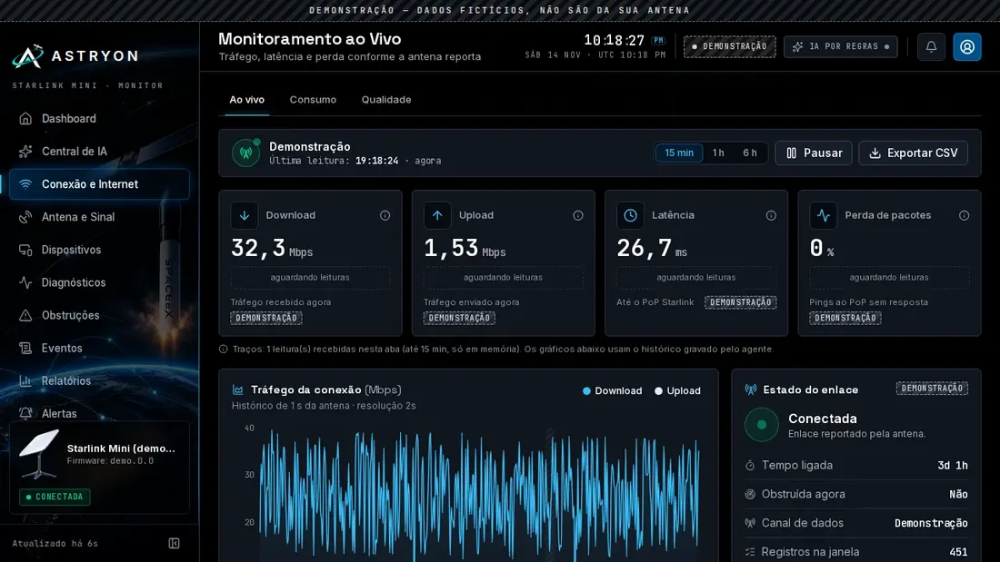
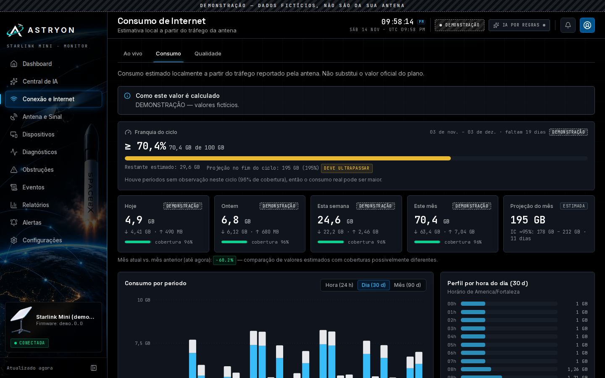
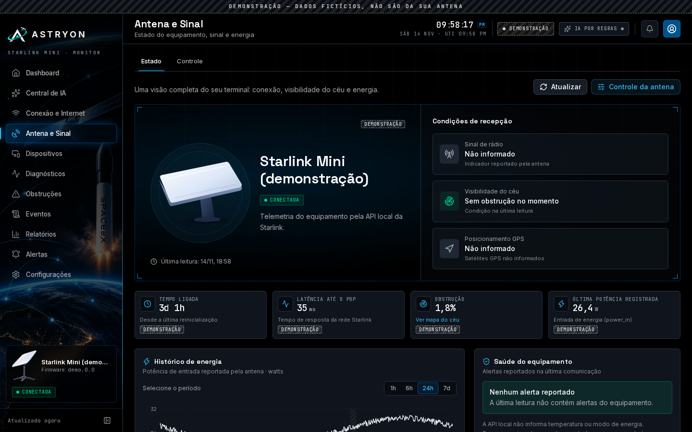
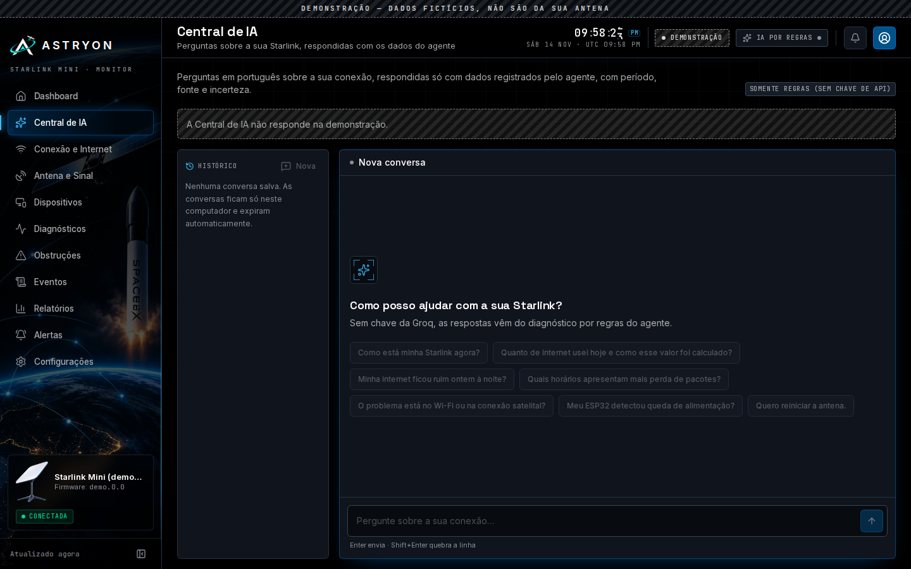
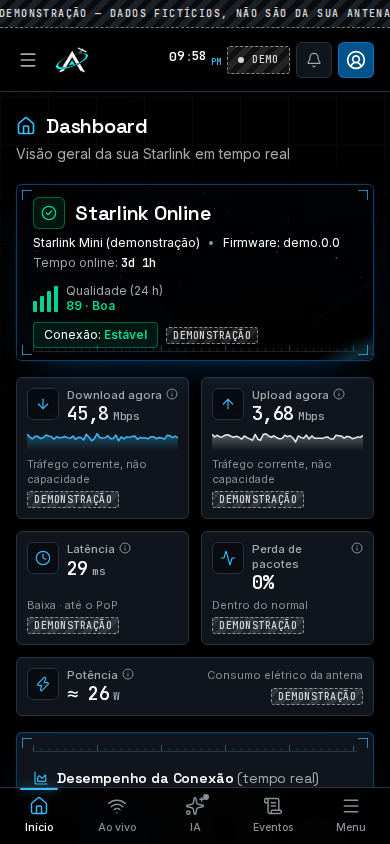

<div align="center">


### Monitoramento local das antenas Starlink

Painel em tempo real, alertas no Telegram, assistente de IA e controle seguro da antena.
Tudo rodando na sua rede, sem nuvem obrigatória e sem dado inventado.


</div>

<p align="center">
  <br>
  <sub>Tela Ao Vivo na demonstração (dados fictícios, acelerada 4×).</sub>
</p>

## Início rápido

```bash
git clone https://github.com/carlosnj497-lgtm/orbitlink-ai.git ~/astryon && cd ~/astryon
sudo bash deploy/linux/install.sh
sudo cat /etc/astryon/setup-code   # abra https://SEU-IP/ e crie o administrador
```

Pronto: o agente passa a ler a sua antena. No Windows, veja [Instalação](#instalação). Sem antena por perto, abra `/demo`.

> **ASTRYON** é o nome do projeto, do painel e dos pacotes. As variáveis usam o prefixo `ASTRYON_*`,
> os serviços usam `astryon-*` e o comando de administração é `astryonctl`.
> Projeto independente, sem afiliação com a Starlink ou a SpaceX. Usa apenas a API local gRPC que a
> própria antena expõe na sua rede.
>
> Voltado aos diferentes modelos de antena Starlink: **Mini, Standard (incluindo gerações anteriores),
> Standard Actuated, High Performance e Flat High Performance**. A compatibilidade e os recursos
> disponíveis dependem da API local gRPC exposta por cada modelo e firmware. A validação em antenas
> reais ainda está pendente.

Para atualizar uma instalação com o nome anterior, veja [Migração para ASTRYON](docs/MIGRATION_ASTRYON.md).

---

## Sumário

<p align="center">
  <a href="#por-que-o-astryon"></a>
  <a href="#início-rápido"></a>
  <a href="#arquitetura"></a>
  <br>
  <a href="#o-que-ele-faz"></a>
  <a href="#instalação"></a>
  <a href="#estado-do-projeto"></a>
  <br>
  <a href="#telas"></a>
  <a href="#telegram-e-ia"></a>
  <a href="#roteiro"></a>
  <br>
  <a href="#princípios"></a>
  <a href="#perguntas-frequentes"></a>
  <a href="#documentação"></a>
</p>

## Por que o ASTRYON?

O app oficial da Starlink mostra como a antena está agora. O ASTRYON guarda tudo o que a antena reporta,
segundo a segundo, e transforma isso em histórico, alertas e respostas.

| | O que você ganha |
|---|---|
| 🗂️ **Histórico seu** | Amostras de 1 s guardadas no seu computador, com agregados por minuto mantidos por mais de um ano. |
| 🌙 **Quedas de madrugada** | Cada interrupção fica registrada com horário e duração (e a causa, quando a antena informa), mesmo com ninguém olhando. |
| 📦 **Franquia sob controle** | Consumo do ciclo, projeção do mês e aviso no Telegram em 80% e 100% do plano. |
| 📲 **Avisos no celular** | Alertas, resumo semanal e consultas por comando no Telegram, sem abrir o painel. |
| 🌧️ **Foi a chuva?** | O clima da sua cidade aparece junto da conexão: dá para ver se uma queda coincidiu com chuva forte. |
| 🗣️ **Pergunte em português** | "Minha internet ficou ruim ontem à noite?" Resposta com período, fonte e incerteza. |
| 🔒 **Dados com você** | Tudo roda na sua rede. Nada sai sem você configurar, e a nuvem é opcional. |

## O que ele faz

| | Recurso | Detalhes |
|---|---|---|
| 📡 | **Ao vivo** | Download, upload, latência e perda de pacotes a cada segundo, com histórico, pausa e exportação CSV. |
| 📊 | **Consumo e franquia** | Consumo do ciclo, projeção mensal e alertas em 80% e 100% do plano (estimativa local pelo tráfego da antena). |
| ✅ | **Qualidade** | Disponibilidade, perda, jitter e percentis de latência por hora, comparação com o período anterior (com e sem chuva) e os melhores horários do dia. Segundos sem medição ficam fora da conta. |
| 🛰️ | **Antena e obstruções** | Estado, firmware, mapa de céu visto pela antena e porcentagem de obstrução. |
| 🔔 | **Alertas** | Regras com debounce, histerese e cooldown, entregues pelo Telegram ou por webhook, com fila que sobrevive à queda da internet. |
| 🤖 | **Central de IA** | Perguntas em português respondidas com os dados do agente (Groq). Sem chave, responde por regras. |
| 💬 | **Bot do Telegram** | `/menu`, consultas por comando sem gastar IA, perguntas em texto ou nota de voz e resumo semanal. |
| 🔁 | **Controle seguro** | Reiniciar a antena exige administrador, código de uso único e fica auditado. A IA só sugere. |
| 🌦️ | **Clima (opcional)** | Clima da sua cidade pela Open-Meteo (gratuita): cartão no Dashboard, faixas de chuva nos gráficos e o tempo de cada queda em Eventos. |
| 🔌 | **ESP32 (opcional)** | Sensores de tensão, falta de energia e temperatura, autenticados por HMAC. |
| 🏠 | **Home Assistant (opcional)** | Sensores da Starlink no Home Assistant via MQTT, com descoberta automática. Veja [HOME_ASSISTANT.md](docs/HOME_ASSISTANT.md). |
| ☁️ | **Supabase (opcional)** | Sincronização com RLS. O painel continua lendo só o agente local. |

## Telas

<table>
  <tr>
    <td width="50%"><br><sub><b>Consumo</b>: ciclo, projeção e evolução diária.</sub></td>
    <td width="50%"><br><sub><b>Antena e Sinal</b>: estado, firmware e obstruções.</sub></td>
  </tr>
  <tr>
    <td><br><sub><b>Central de IA</b>: perguntas sobre a conexão com histórico de conversas.</sub></td>
    <td><br><sub><b>Login</b>: administrador local criado na instalação.</sub></td>
  </tr>
</table>

<details>
<summary><b>Dashboard completo e versão para celular</b></summary>
<br>
<p align="center">
  
  &nbsp;
  
</p>
</details>

Todas as capturas vêm da rota `/demo`, com dados fictícios e a faixa de demonstração sempre visível.

## Princípios

- **Funciona 100% local.** Sem Docker e sem serviço pago. Supabase, IA e ESP32 são opcionais.
- **Toda métrica mostra a origem**: `real`, `calculada`, `estimada`, `importada`, `sensor_esp32`, `indisponível` ou `demonstração`.
- **Nada é inventado.** Campo que o firmware não informa aparece como indisponível. Lacuna de observação nunca vira zero, e tráfego corrente nunca é chamado de teste de velocidade.
- **Ações só com confirmação humana.** A IA tem ferramentas somente de leitura.
- **Demonstração isolada.** Dados fictícios existem só em `/demo`, sempre sinalizados.

## Instalação

**Pré-requisitos:** Python 3.11+ e Node.js 20+ (LTS). Computador na mesma rede da antena (o agente precisa alcançar o IP local dela).

### Servidor Linux (Ubuntu Server 24.04 LTS), recomendado

```bash
git clone https://github.com/carlosnj497-lgtm/orbitlink-ai.git ~/astryon && cd ~/astryon
sudo bash deploy/linux/install.sh        # systemd + Nginx (TLS) + UFW
sudo cat /etc/astryon/setup-code       # código para criar o 1º administrador
```

Depois abra `https://SEU-IP/` (o IP do servidor na sua rede) e crie o administrador. Opções do instalador: `--with-tailscale`, `--esp32` e `--harden-ssh`.

```bash
sudo astryonctl status | logs agent -f | diagnose | doctor | restart | update --git-pull | rollback | backup
```

Os serviços `astryon-agent` e `astryon-web` reiniciam sozinhos em falhas e registram no journald. Agente e painel escutam só em loopback; o Nginx publica o painel apenas para a LAN e a Tailnet. Guia completo: [docs/LINUX_SERVER.md](docs/LINUX_SERVER.md).

### Windows 10/11 (PowerShell)

```powershell
powershell -ExecutionPolicy Bypass -File scripts\install.ps1    # venv, npm, .env com token, build
powershell -ExecutionPolicy Bypass -File scripts\diagnose.ps1   # rede + antena (somente leitura)
powershell -ExecutionPolicy Bypass -File scripts\start.ps1      # agente :8787 + painel :3000
```

Abra `http://localhost:3000` no próprio PC e crie o administrador. Para parar: `scripts\stop.ps1`. Guia: [docs/WINDOWS_SETUP.md](docs/WINDOWS_SETUP.md).

> Sem antena por perto? Abra `/demo` para ver o painel com dados fictícios.

## Telegram e IA

1. Crie um bot no [@BotFather](https://t.me/BotFather) e coloque o token em `ASTRYON_TELEGRAM_BOT_TOKEN`.
2. Descubra o chat autorizado com `sudo astryonctl telegram-chat-id` (ou `python -m astryon_agent telegram-chat-id`) e preencha `ASTRYON_TELEGRAM_CHAT_ID`.
3. Opcional: coloque uma chave da [Groq](https://console.groq.com/keys) em `ASTRYON_GROQ_API_KEY` para respostas com IA e transcrição de notas de voz (Whisper).

| Comando | O que mostra |
|---|---|
| `/menu` | Central com botões |
| `/status` | Diagnóstico das últimas 24 h |
| `/consumo 7d` | Download, upload e cobertura no período |
| `/franquia` | Limite, saldo estimado e projeção do ciclo |
| `/qualidade` · `/quedas` · `/alertas` | Qualidade, interrupções (com o clima de cada uma) e alertas ativos |
| `/clima` | Clima agora, próximas horas e aviso de chuva forte |
| `/horario` | Melhores horários para downloads e chamadas |
| `/resumo` | Resumo dos últimos 7 dias |
| `/relatorio` | PDF dos últimos 30 dias, com comparação e clima |

Consultas por comando não gastam IA. Perguntas em texto ou voz usam a cota diária, compartilhada com o painel. Todos os comandos: [docs/TELEGRAM.md](docs/TELEGRAM.md).

## Arquitetura

```
 Navegador ──HTTPS──▶ Nginx ──▶ Painel Next.js (local, porta 3000)
                                  │  /api/auth/*   login → cookie httpOnly, SameSite=Strict
                                  │  /api/agent/*  proxy autenticado (+ SSE), token nunca vai ao navegador
                                  ▼
                       Agente FastAPI (local, porta 8787) ──gRPC──▶ Antena Starlink (IP da antena, porta 9200)
                         ├─ Coletor (status 10 s · histórico 30 s · obstrução 5 min)
                         ├─ SQLite WAL + migrações + retenção automática
                         ├─ Alertas · Diagnóstico por regras · Relatórios · Controle auditado
                         ├─ Bot do Telegram · IA Groq (somente leitura) · Whisper
                         ├─ Clima opcional ──HTTPS──▶ Open-Meteo (só as coordenadas da cidade)
                         └─ Sync opcional ──HTTPS──▶ Supabase (RLS)
                       Listener ESP32 (opcional, HMAC) ◀── sensores na LAN
```

| Pasta | Conteúdo |
|---|---|
| `apps/agent/` | Agente Python: FastAPI, gRPC por reflection, SQLite, SSE, alertas, IA, Telegram e sync |
| `apps/web/` | Painel ASTRYON: Next.js 16 (App Router), Tailwind 4, TanStack Query, Recharts |
| `apps/esp32-firmware/` | Firmware PlatformIO/Arduino do nó ESP32 |
| `packages/shared/` | Contratos TS e tipos gerados do OpenAPI do agente |
| `supabase/` | Migrações SQL com RLS e testes de isolamento (PGlite) |
| `deploy/linux/` | Instalador, systemd, Nginx, UFW e `astryonctl` |
| `scripts/` | Scripts do Windows e emulador do ESP32 |

Decisões de projeto e fluxo de dados: [docs/ARCHITECTURE.md](docs/ARCHITECTURE.md).

## Estado do projeto

| Componente | Situação |
|---|---|
| Conector gRPC | Testado contra servidor gRPC sintético com reflection. **Ainda não validado em antenas reais**; a compatibilidade por modelo e firmware precisa ser confirmada. |
| Agente | 169 testes pytest, ruff e mypy strict. Dependências travadas com hash. |
| Painel | 56 testes Vitest e 9 E2E Playwright (incluindo acessibilidade com axe). |
| Telegram e notificações | Comandos, fila de reenvio e resumo semanal testados com servidor simulado. |
| IA (Groq) e Whisper | Testados com o endpoint real da Groq; áudio validado com voz sintética. |
| Supabase | 11 testes de isolamento RLS em Postgres (PGlite). Ainda não aplicado a um projeto real. |
| Firmware ESP32 | Compila (`esp32dev` e `esp32dev_sensors`). Ainda não gravado em placa. |
| Implantação Linux | 51 testes dos scripts e instalação real num Ubuntu 24.04 limpo no CI. |
| Painel remoto via Supabase | Não implementado: a nuvem recebe os dados, mas o painel lê só o agente local. |

## Roteiro

- [x] Coleta gRPC por reflection, histórico de 1 s e agregados por minuto
- [x] Painel ASTRYON com Ao Vivo, Consumo, Qualidade, Antena, Obstruções, Eventos e Relatórios
- [x] Alertas com fila de reenvio, bot do Telegram e resumo semanal
- [x] Central de IA (Groq) e notas de voz transcritas pelo Whisper
- [x] Instalação no Ubuntu com systemd, Nginx e UFW, testada no CI
- [x] Clima da cidade (Open-Meteo) cruzado com a qualidade e as quedas
- [x] Aviso de chuva forte prevista no Telegram e comando `/clima`
- [ ] Validação em antenas Starlink reais dos diferentes modelos e gerações
- [ ] Nó ESP32 gravado e testado numa placa
- [ ] Painel remoto lendo os dados sincronizados no Supabase
- [ ] Instalador `.exe` para Windows com ícone na bandeja: pronto para gerar no GitHub Actions, falta validar num Windows real

## Perguntas frequentes

<details>
<summary><b>Quais modelos de antena Starlink posso usar?</b></summary>
<br>
O projeto é voltado aos modelos Starlink em geral, incluindo <b>Mini, Standard (e gerações anteriores),
Standard Actuated, High Performance e Flat High Performance</b>, desde que exponham a API local gRPC
acessível ao agente (IP da antena, porta 9200). O agente descobre em tempo de execução quais chamadas
o firmware oferece; o que não for informado aparece como indisponível. A validação em hardware real
ainda está pendente, portanto não há garantia de compatibilidade completa com todos os modelos e firmwares.
Detalhes em <a href="docs/STARLINK_COMPATIBILITY.md">STARLINK_COMPATIBILITY.md</a>.
</details>

<details>
<summary><b>Preciso de um servidor ligado o tempo todo?</b></summary>
<br>
Para monitorar 24 horas, sim: qualquer mini PC ou computador antigo com Ubuntu serve. No Windows, o monitoramento
acontece enquanto o computador estiver ligado.
</details>

<details>
<summary><b>Meus dados vão para algum lugar?</b></summary>
<br>
Não por padrão. Tudo fica no SQLite local. Só sai alguma coisa se você ativar o Telegram, a IA da Groq (a pergunta e
os dados necessários para respondê-la), as respostas em voz do bot (o texto da resposta vai ao serviço de voz da
Microsoft), o clima (só as coordenadas da cidade escolhida, arredondadas a cerca de 1 km, vão para a Open-Meteo) ou a
sincronização com o seu próprio projeto Supabase.
</details>

<details>
<summary><b>O clima diz que a chuva derrubou a minha internet?</b></summary>
<br>
Não. Ele mostra que as duas coisas aconteceram ao mesmo tempo, o que ajuda a investigar, mas não prova a causa. O clima
vem de um modelo meteorológico para a sua região, não de um sensor no seu telhado, por isso aparece como dado
<b>estimado</b>. Para ativar, escolha a cidade em Configurações → Clima; sem cidade, nada é buscado.
</details>

<details>
<summary><b>Quanto custa?</b></summary>
<br>
O projeto não tem custo. Telegram e o clima (Open-Meteo) são gratuitos. A IA usa a sua própria chave da Groq, que tem plano gratuito; sem chave,
o assistente responde por regras. Há cotas diárias configuráveis para texto e áudio.
</details>

<details>
<summary><b>O consumo mostrado é o mesmo da fatura?</b></summary>
<br>
Não necessariamente. O consumo é estimado pelo tráfego que a antena reporta a cada segundo, e o painel deixa isso claro.
Períodos sem observação ficam fora da conta. Para comparar, importe o CSV da sua conta Starlink.
</details>

<details>
<summary><b>A IA pode reiniciar a minha antena?</b></summary>
<br>
Não. As ferramentas da IA são somente de leitura. Reiniciar exige um administrador, um código de uso único e fica
registrado na auditoria.
</details>

## Desenvolvimento

| Comando (na raiz) | O que faz |
|---|---|
| `npm run dev` | Painel em modo desenvolvimento |
| `npm run test` | pytest + Vitest + testes de RLS |
| `npm run test:e2e` | Playwright: agente em modo fixture + painel em produção |
| `npm run lint` · `npm run typecheck` | ESLint + ruff · tsc + mypy strict |
| `npm run build` | Build de produção do painel |
| `npm run diagnose` | Diagnóstico da rede e da antena |
| `npm run gen:types` | Regenera os tipos TS a partir do OpenAPI do agente |
| `npm run lock:agent` | Regenera os `.lock` do Python (requer `uv`) |
| `npm run audit` | Vulnerabilidades conhecidas (`npm audit` + `pip-audit`) |
| `npm run test:deploy` | Testes dos scripts do servidor Linux |

Ao mudar dependências em `apps/agent/pyproject.toml`, rode `npm run lock:agent` e faça commit dos dois `.lock`: o CI falha se estiverem desatualizados.

O CI ([`.github/workflows/ci.yml`](.github/workflows/ci.yml)) roda agente, painel, Supabase, E2E, scripts, auditoria de vulnerabilidades e uma instalação real no Ubuntu a cada push e pull request.

## Documentação

| Guia | Assunto |
|---|---|
| [LINUX_SERVER.md](docs/LINUX_SERVER.md) | Servidor Ubuntu: instalação, atualização, backup e rollback |
| [WINDOWS_SETUP.md](docs/WINDOWS_SETUP.md) | Instalação no Windows |
| [TELEGRAM.md](docs/TELEGRAM.md) | Bot, comandos, voz e resumo semanal |
| [ARCHITECTURE.md](docs/ARCHITECTURE.md) | Decisões e fluxo de dados |
| [STARLINK_COMPATIBILITY.md](docs/STARLINK_COMPATIBILITY.md) | O que a API local informa e o que não informa |
| [SECURITY.md](docs/SECURITY.md) | Modelo de segurança |
| [ESP32_SETUP.md](docs/ESP32_SETUP.md) | Montagem e pareamento do ESP32 |
| [SUPABASE.md](docs/SUPABASE.md) | Sincronização opcional com a nuvem |
| [HOME_ASSISTANT.md](docs/HOME_ASSISTANT.md) | Sensores no Home Assistant via MQTT |
| [TROUBLESHOOTING.md](docs/TROUBLESHOOTING.md) | Solução de problemas |
| [ACCEPTANCE_TESTS.md](docs/ACCEPTANCE_TESTS.md) | Testes de aceitação |

## Créditos

Desenvolvido por [@carlosnj497-lgtm](https://github.com/carlosnj497-lgtm). Distribuído sob a [licença MIT](LICENSE).

A leitura do histórico circular da antena segue o modelo documentado pela
[starlink-grpc-tools](https://github.com/sparky8512/starlink-grpc-tools) (Unlicense). O código foi reescrito, não copiado.
